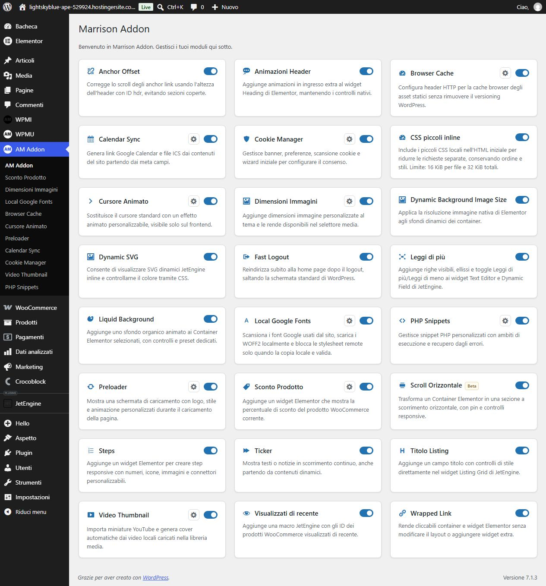
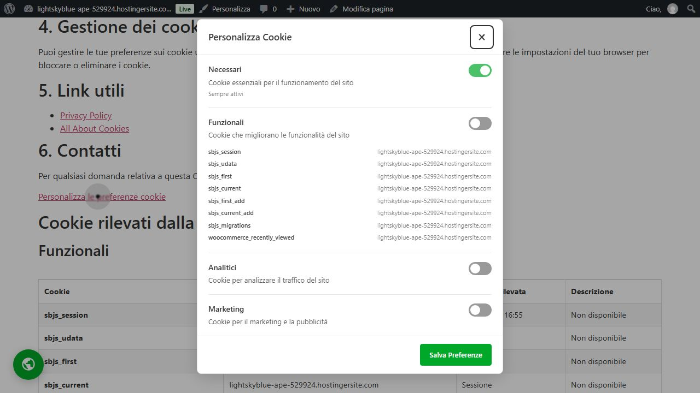

# Marrison Addon 1.3.67 — interventi e verifiche

Versione **1.3.67**, installata e verificata il 20 ottobre 2026 sul [sito di test](https://lightskyblue-ape-529924.hostingersite.com/). Il pacchetto locale [marrison-addon.zip](../../marrison-addon.zip) contiene 97 file, tutti confrontati byte per byte con i sorgenti, con controllo CRC superato. Le modifiche locali preesistenti sono state conservate. Nessun commit o push eseguito.

Gli ID corrispondono al [report dell'audit](../2026-10-19/REPORT.md). Le prove locali, le verifiche browser e i limiti dell'hosting sono distinti sotto.

## Interventi per priorità

| Priorità | ID | Modifica completata | Verifica principale |
|---|---|---|---|
| P1 | R01 | Consenso in verifica distinto dal rifiuto: conserva i cookie preesistenti, blocca nuove scritture/risorse opzionali; pulizia dopo stato negativo confermato. | Suite runtime JS e consenso PHP. |
| P2 | R02 | Salvataggi singoli, cumulativi, Settings API e update diretti condividono cleanup, invalidazione cache e notifiche. Errori di cleanup/database restituiscono errore. | Dispatcher hook WordPress nativo, errori simulati, toggle reali. |
| P2 | R03 | Disattivazione plugin: rimozione cron propri con tutti gli argomenti, code Action Scheduler, regole server Marrison e cache CSS Elementor. Dati/configurazione conservati; errore se il cleanup non riesce. Callback pianificate bloccate anche dopo OFF nella stessa richiesta. | Fixture lifecycle, varianti AS/WP-Cron; disattivazione e riattivazione native sul sito. |
| P2 | R04 | Toggle Dimensioni Immagini invalida i CSS generati da Elementor. | Fixture lifecycle con un'unica invalidazione anche per aggiornamento cumulativo. |
| P2 | R05 | Inventario cookie e categorie manuali conservati oltre 30 giorni; risultati datati segnalati. Coerenza tra tabella e JSON, senza cancellazioni distruttive nelle scansioni parziali. | Fixture SQL/JSON, dati di oltre 30 giorni e policy. |
| P2 | R06 | Date calendario senza offset interpretate nel fuso WordPress, inclusi cambi ora legale; timestamp e offset espliciti conservati. | Suite Calendar Sync. |
| P2 | R07 | Anchor Offset rispetta target, target ereditato, download e modificatori tastiera. | Suite JS. |
| P2 | R08 | Preloader nascosto finché il suo JS non parte: nessun overlay permanente in caso di asset mancante. | Sorgente/fixture preloader. |
| P2 | R09 | Dialogo preferenze nominato, focus confinato, sfondo inert, Escape e ritorno al comando di apertura. | Browser remoto con Tab/Shift+Tab, Escape e controllo attributi DOM. |
| P2 | R10 | Slug dimensioni personalizzate univoci, senza collisioni con dimensioni WordPress/tema/plugin; difesa anche su record precedenti. Altezza zero proporzionale mantenuta. | Suite Image Sizes. |
| P2 | R11 | Asset Leggi di più condizionati all'uso nel documento e nei template/listing collegati, con supporto del rendering tardivo. | Fixture Read More; homepage remota senza istanze priva dei suoi asset. |
| P3 | M01 | Preloader ripristinato su pageshow da cache di navigazione. | Fixture JS con evento persisted; BFCache reale non forzata sul sito. |
| P3 | M02 | RAF cursore sospeso a riposo, invisibile, fuori pagina o nelle zone escluse; riparte al movimento. | Suite JS con conteggio callback. |
| P3 | M03 | Font con provenienza per famiglia/variante; priorità ai CSS del frontend. Candidati trovati solo nei sorgenti visibili come diagnostica ed esclusi dal download automatico. | Parser e fixture; nessun download massivo eseguito sul sito. |
| P3 | M04 | Importazione YouTube vincolata all'ID selezionato e agli host/percorso delle miniature ammessi. | Suite PHP, inclusi URL non coerenti ed exec disabilitato. |
| P3 | M05 | Ticker usa un CSS statico condiviso, dichiarato come dipendenza del widget. | Fixture multipla; render homepage remoto. |
| P3 | M06 | Oltre 50 prodotti accodati, sincronizzazione in blocchi fino a 50 via Action Scheduler o WP-Cron, con deduplicazione e cleanup OFF. | Fixture importazione 1.000 ID: 20 blocchi, due backend. Nessun benchmark su catalogo reale. |
| P3 | M07 | SVG limitati anche per complessità: 20.000 nodi/attributi, profondità 128 e cache aggiornata. | Suite SVG con file validi ed eccessivamente complessi. |

Dimensioni Immagini: il resolver pubblico degli sfondi limita input e risoluzioni mancanti a 10 per richiesta, con cache a 256 slot. Il JS suddivide le richieste in blocchi compatibili. Le suite verificano URL canonici dello stesso sito, cache e limiti.

## Modifiche grafiche richieste

- Finestra cookie sobria: superficie bianca, separatori sottili, tipografia e spaziature compatte, colori dei controlli configurati; larghezza massima 560 px e scorrimento interno quando necessario.
- Dieci icone impostazioni da **26 × 26 px**, nell'intestazione delle card, con nome accessibile e focus visibile. Disponibili per tutti i moduli con pagina propria; disabilitate quando modulo/dipendenze sono OFF. Le dieci pagine sono state aperte senza accessi negati o errori critici.
- Etichetta **Beta** su Scroll Orizzontale. Il comportamento dello scroll non è stato riscritto.

## Prove locali

**39 file suite distinti, 45 esecuzioni PASS**: 34 PHP incluse varianti e quattro scenari del menu WordPress nativo, 11 Node con fixture/VM. Ulteriori tre riesami dopo le ultime guardie OFF: PASS. Lint su 71 file PHP/JS e `git diff --check`: PASS. [Log completo e limiti](verifiche-locali.txt).

La fixture lifecycle usa gli hook nativi WordPress, con option/cron simulati e un file .htaccess temporaneo reale: tutti i **24 moduli OFF → zero file/classi dei moduli**. Comprende salvataggi diretti/AJAX/cumulativi, errori di persistenza, errori nella pulizia server/cron, capability snippet e deactivation hook.

Non sono prove su un database Elementor completo, su ogni tema/browser o su cataloghi reali. Le simulazioni FFmpeg verificano i contratti, non estraggono fotogrammi reali. La compatibilità minima dichiarata resta PHP 7.4; il runtime CLI di queste prove è PHP 8.5.5, senza una matrice di esecuzione su ogni versione intermedia.

## Prove sul sito aggiornato

1. Caricamento ZIP e sostituzione tramite il flusso nativo WordPress. Pagina Plugin: **Versione 1.3.67**, attivo.
2. Dieci impostazioni raggiungibili; icone misurate 26 × 26 px e Beta visibile. [Esiti pagine](evidence/impostazioni.json).
3. Preferenze aperte dalla Cookie Policy, lista osservazioni caricata, salvataggio delle categorie opzionali disattivate e verifica dopo reload; nessun errore console rilevato. Focus da primo a ultimo e viceversa con Shift+Tab/Tab, Escape e ritorno al link; sfondo con attributo inert mentre aperto.
4. Tutti i 24 toggle OFF e reload del pannello: **0/24 attivi** e collegamenti impostazioni non disponibili. Homepage ricaricata: **0 CSS/JS esterni Marrison, 0 contributi inline Marrison, 0 elementi Marrison**. [Pannello](evidence/moduli-off.json), [frontend](evidence/frontend-off.json).
5. Ripristino **24/24 ON**. Disattivazione dell'intero plugin: WordPress conferma inattivo e frontend senza contributi Marrison. Riattivazione: **1.3.67 attiva, 24/24 ON conservati**. [Frontend plugin inattivo](evidence/plugin-off-frontend.json), [configurazione ripristinata](evidence/moduli-ripristinati.json).
6. Browser Cache riapplica le proprie regole al ritorno ON; verifica pubblica: **11/12 asset corretti**, con il limite WOFF descritto sotto. [Diagnostica](evidence/cache-diagnostic.json).

La prova OFF riguarda il caricamento del plugin nella pagina successiva. Non certifica l'eliminazione di copie già presenti in cache esterne o direttive server estranee al plugin. La rimozione delle sole regole gestite e delle code con argomenti è coperta anche dalle fixture locali.

## Esclusioni e problemi rimasti

- **S01 escluso:** il 404 Privacy Policy è intenzionale in questo sito di test. Nessuna pagina creata e nessun URL o testo editoriale modificato. Lo scanner può correttamente dichiarare copertura parziale per quel campione.
- **S02, hosting:** `WooCommerce.woff` continua a rispondere HTTP 200 senza Cache-Control/Expires, mentre WOFF2, TTF e gli altri asset verificati passano. Le regole generate includono già WOFF, confermato anche dalla regressione. Nessuna causa del plugin dimostrata: resta da isolare sul livello server/cache con accesso all'hosting. Non è dichiarato risolto.
- **FFmpeg:** il server di test non ne consente l'esecuzione; il modulo continua a segnalarlo correttamente. Non è una correzione PHP possibile in questo ambiente.

Stato finale: plugin aggiornato, tutti i 24 moduli attivi come all'inizio, preferenze/browser di test con categorie opzionali disattivate. Le prove hanno aggiornato la diagnostica cache e una ricevuta consenso; non sono state eseguite rigenerazioni massive dei media, modifiche a snippet o testi delle pagine.

## File principali interessati

- Lifecycle, registro, versione: `marrison-addon/marrison-addon.php`.
- Card e impostazioni: `includes/admin/class-marrison-addon-admin.php`, `assets/css/admin.css`.
- Cookie: `includes/modules/cookie-manager/` e bootstrap del modulo; CSS/JS frontend, scanner, inventario e template.
- Correzioni circoscritte nei moduli Calendar Sync, Image Sizes, Local Google Fonts, Browser Cache, Product Discount, Read More, Ticker, Dynamic SVG, Video Thumbnail, Preloader e negli script Anchor Offset/Cursor.
- Release: `README.md`, `marrison-addon.zip`; regressioni in `tests/`. Il pacchetto contiene soltanto il plugin, senza audit, test o AGENTS.md.
