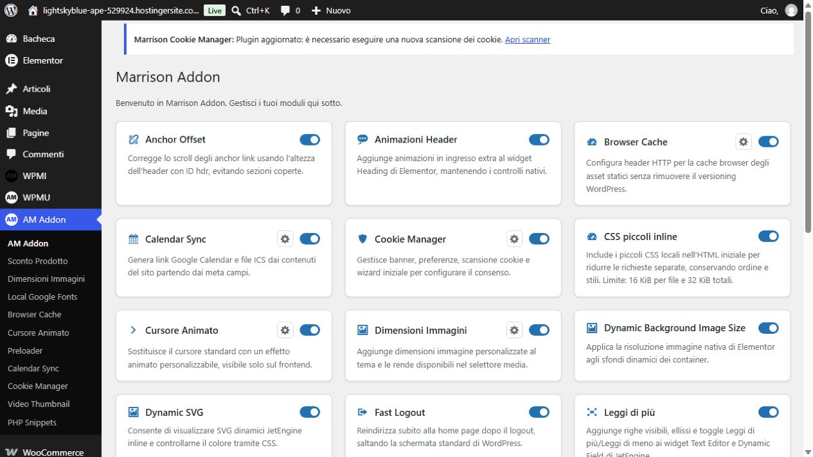
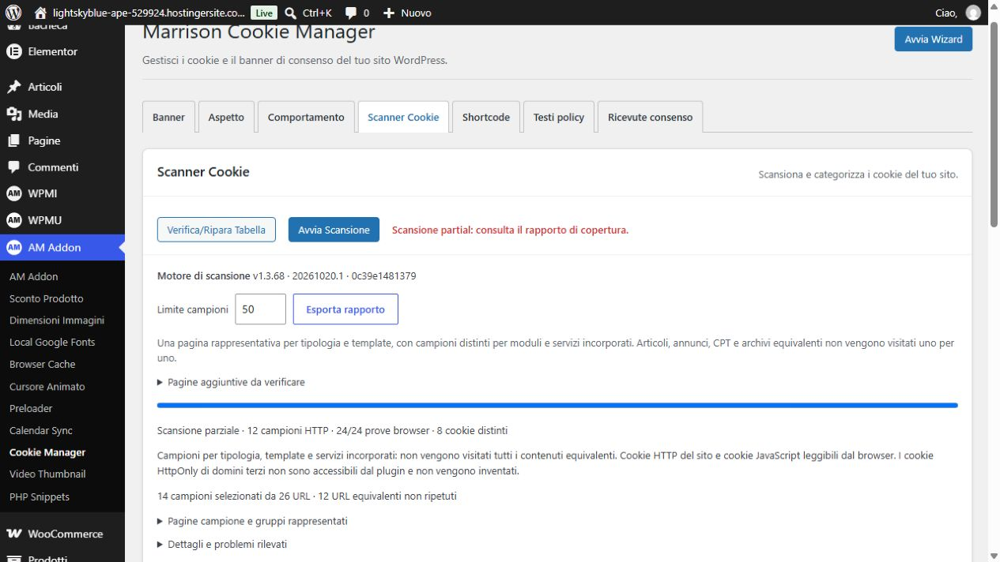

# Marrison Addon 1.3.68

Release completata il 20 ottobre 2026. Autore: **Angelo Marra**, https://marrisonlab.com. Pacchetto [marrison-addon.zip](../../../marrison-addon.zip), installato sul sito di test. Nessun commit, push o pubblicazione GitHub eseguito.

## Avviso Cookie Manager

- Una versione del modulo già installata e inferiore alla versione aggiornata imposta la richiesta di nuova scansione. Le prime installazioni continuano a utilizzare il wizard.
- Avviso amministrativo compatto con link diretto allo scanner, visibile solo agli utenti con manage_options e con Cookie Manager attivo. Nessun CSS/JS aggiuntivo per l'avviso. Il modulo OFF conserva l'esclusione dei propri file/hook/asset dal bootstrap.
- La richiesta resta memorizzata attraverso i reload e lo spegnimento/riaccensione del modulo. Una scansione precedente all'aggiornamento non può soddisfarla.
- Ogni nuova scansione salva la versione del plugin con cui è iniziata. Dopo il salvataggio di inventario e rapporto, la conclusione delle misurazioni browser notifica il modulo. L'avviso viene rimosso solo se tutte le prove browser previste sono terminate senza errori e la versione corrisponde alla richiesta.
- Le scansioni fallite, annullate, solo HTTP o incomplete non lo rimuovono. Una scansione terminata con un HTTP 404 può restare correttamente parziale senza essere considerata mai eseguita. La privacy assente sul sito di test resta intenzionale.
- L'interfaccia scanner rimuove l'avviso subito dopo la conferma del server; al reload resta assente. Revisione asset scanner aggiornata a 20261020.1 per evitare codice browser obsoleto.

## Versione, documentazione e compatibilità

- Versione PHP header/const, stable tag e changelog allineati a **1.3.68**.
- [README.md della repository](../../../README.md): presentazione GitHub, autore, requisiti, moduli e procedura tag/Release.
- [README.md del plugin](../../../marrison-addon/README.md): documentazione completa e storico changelog conservato, con nuova sezione 1.3.68.
- [readme.txt WordPress](../../../marrison-addon/readme.txt): intestazioni standard, descrizione sotto 150 caratteri, cinque tag, sezioni installazione/FAQ/changelog/upgrade notice e servizi esterni. Dimensione 8.241 byte. Angelo Marra è accreditato nel testo; non è stato inventato un nome utente WordPress.org per Contributors.
- Header PHP nativi Requires at least, Requires PHP e licenza aggiunti; autore Angelo Marra. Metadati tested dell'updater allineati a WordPress 7.1.3.
- Versioni stabili verificate sulle fonti ufficiali: [WordPress 7.1.3](https://wordpress.org/download/releases/) e [PHP 8.5.11](https://www.php.net/). Il readme WordPress usa Tested up to: 7.1 come serie, e specifica 7.1.3 nel testo. PHP 8.6 RC non è il target stabile.
- Requisiti minimi conservati: WordPress 6.0 / PHP 7.4. Il campo Requires PHP rappresenta il minimo; la compatibilità recente è indicata separatamente.

## Verifiche

**PHP 8.5.11 ufficiale portatile**, SHA256 del pacchetto verificato contro il sito PHP: `0ea96e0d2b9b737a6036f05cf4e95c49313faa6d0f27bd97edb2742503f0c043`.

- **35 esecuzioni PHP PASS**, incluse le varianti Action Scheduler, exec disabilitato, WP_Http_Cookie nativo e quattro scenari menu WordPress. Nessuna diagnostica PHP di deprecazione o warning rilevata. [Log](php-8.5.11-verification.json).
- **55 file PHP del plugin: lint PASS**.
- Nuova suite avviso: upgrade/fresh install, persistenza, permessi, ON/OFF, IT/EN, link scanner, job vecchi/falliti/incompleti e conclusione anche parziale. Il motore verifica l'emissione della notifica solo dopo la fase browser, con versione del job.
- Dopo l'ultimo ritocco alla rimozione immediata dell'avviso: rieseguiti motore cookie, avviso e lifecycle, più lint dei due file PHP interessati e sintassi JS scanner, tutti PASS.
- Parser delle sezioni del vero updater provato su entrambi i README Markdown: Description, Installation e Changelog 1.3.68 presenti.
- Verifica metadati/readme, integrità CRC e confronto byte per byte dei **98 file** ZIP: PASS. [Pacchetto](package-results.json). Il pacchetto esclude test, audit, AGENTS.md e il README introduttivo esterno alla directory del plugin.
- `git diff --check`: PASS.

Le suite locali usano fixture e API native dell'installazione WordPress locale 7.1.2, senza un database WordPress completo; PHP 8.5.11 è stato eseguito realmente. Le verifiche sotto sono state eseguite realmente sul sito WordPress 7.1.3. Non costituiscono una matrice completa di ogni modulo con ogni versione di tema, Elementor, WooCommerce o JetEngine.

## Verifica nel sito di test

1. Aggiornamento nativo WordPress alla 1.3.68 e lettura dell'autore Angelo Marra nella pagina Plugin. Requisiti minimi riconosciuti dall'installatore.
2. Avviso visibile nel pannello moduli; nessun asset cookie aggiunto dall'avviso. Cookie Manager OFF: avviso assente e zero asset del modulo. Ritorno ON: avviso di nuovo presente. [Prova](notice-on-off.json).
3. Link Apri scanner corretto. Nuova scansione con motore v1.3.68 / revisione 20261020.1: 14 campioni selezionati da 26 URL, 12 campioni HTTP, **24/24 prove browser**, 8 cookie distinti.
4. Rapporto parziale per i limiti HTTP del test, inclusa la pagina privacy volutamente assente. Avviso rimosso automaticamente al termine delle prove browser; assente anche dopo il reload. [Prova](scansione-conclusa.json).
5. Stato finale: **24/24 moduli attivi**, avviso assente perché la nuova scansione è già stata eseguita durante la verifica. [Stato](stato-finale.json).

## File funzionali toccati

- `marrison-addon/marrison-addon.php`: versione, autore e header requisiti/licenza.
- `marrison-addon/includes/class-marrison-addon-updater.php`: metadati di compatibilità WordPress.
- `marrison-addon/includes/modules/class-marrison-addon-cookie-manager.php`: stato e rendering dell'avviso, conferma scansione.
- `marrison-addon/includes/modules/cookie-manager/includes/class-scan-engine.php`: versione del job, notifica dopo persistenza e stato richiesta scansione.
- `marrison-addon/includes/modules/cookie-manager/assets/js/scanner.js`: rimozione del notice confermata dal server.
- README GitHub/plugin, nuovo readme WordPress, ZIP e regressioni cookie. Le altre modifiche già presenti nel worktree sono state conservate.
